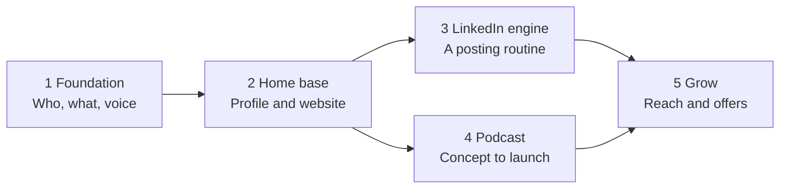

# Personal Brand Roadmap

Jenny Taran · started Oct 29, 2026 · [live doc](https://claude.ai/artifact/8kHjuDcah3pZvacXQnt1rX)

## How to use this roadmap

Work through the phases in order. Each one ends with a "done when" check instead of a date, so you move on when the work is ready, not when the calendar says so.

- Phase 1 comes first: every website page, post and episode draws on it.
- Phases 3 and 4 can run side by side once your LinkedIn profile and website are live.
- Tick items off as you finish them, and add new ones under the phase they belong to.

Ongoing throughout: measure and refine.

Phases 3 and 4 both start once your home base is live, and both feed Phase 5.

## Working with Larry

You and Larry Sequino each build your own brand, and joint work should strengthen both without blurring them.

**Keep separate:** positioning, content pillars, voice, website, LinkedIn profile and posting.

**Good to share:** a joint podcast or recurring episode series, appearing as guests on each other's shows, joint LinkedIn posts or live sessions, tools and templates, and feedback on drafts.

- [ ] Each finish Phase 1 on your own, then compare to make sure your positioning is distinct and complements each other
- [ ] Pick one joint project to start with, e.g. a co-hosted show, or a separate show each with regular guest swaps
- [ ] Agree who owns joint assets (show name, domain, accounts) and what happens if one of you steps back
- [ ] Set a regular check-in to review progress and trade feedback
- [ ] Plan cross-promotion: comment on, share and tag each other's work

## Phase 1: Foundation

Decide who you are for and what you stand for, in one page you can reuse everywhere.

**Positioning and goals**

- [ ] Write a one-sentence positioning statement: "I help \[who\] with \[what\] because \[why me\]"
- [ ] Pick the main goal for the brand (job, clients, speaking, audience, credibility)
- [ ] Define what success looks like for that goal (e.g. inbound messages, bookings, followers)

**Audience**

- [ ] Describe your primary audience: role, industry, what they struggle with
- [ ] List where they spend time online and what they already read or listen to

**Message**

- [ ] Choose 3–5 content pillars, the topics you'll come back to again and again
- [ ] Write your origin story: how you got here and what you learned along the way
- [ ] Gather proof points: results, numbers, testimonials, notable work

**Voice and look**

- [ ] Pick 3 voice words (e.g. warm, direct, curious) and 3 words you are not
- [ ] Collect 3–5 people whose style you admire and note what you'd borrow
- [ ] Settle a simple visual kit: 2–3 colors, 1–2 fonts, a headshot set
- [ ] Check name availability: domain, LinkedIn URL, podcast name, social handles

**Done when:** a one-page brand foundation exists and you'd be happy for a stranger to read it.

## Phase 2: Home base

Make sure anyone who looks you up finds a clear, consistent story.

**LinkedIn profile**

- [ ] Headline built from your positioning statement, not just a job title
- [ ] New headshot and banner that match your visual kit
- [ ] About section: who you help, how, proof, and a call to action
- [ ] Featured section: best work, a talk, or your website
- [ ] Experience entries rewritten around results
- [ ] Set a custom profile URL and add your website link to the intro

**Website**

- [ ] Buy the domain
- [ ] Choose a platform (e.g. Framer, Squarespace, Webflow, or a custom build)
- [ ] Map the pages: Home, About, Work or Services, Podcast, Writing, Contact
- [ ] Write the copy for each page from the brand foundation
- [ ] Design and build the site
- [ ] Add an email signup so visitors can stay in touch
- [ ] Set up basics: analytics, SEO titles, social preview images, mobile check
- [ ] Launch, and link it from LinkedIn and your email signature

**Done when:** your LinkedIn profile and website are live and tell the same story.

## Phase 3: LinkedIn content engine

Build a repeatable way to post, so showing up doesn't depend on inspiration.

**Set up**

- [ ] Map each content pillar to 2–3 post formats (story, lesson, how-to, opinion, carousel, short video)
- [ ] Build a post bank of 20+ ideas, tagged by pillar
- [ ] Write a few hook and closing templates in your voice
- [ ] Choose a posting rhythm you can sustain, and a drafting routine to match
- [ ] Set up a simple tracker for ideas, drafts and published posts

**Run**

- [ ] Draft and publish the first 10 posts
- [ ] Comment thoughtfully on posts from people in your audience and peers each week
- [ ] Note which posts lead to profile views, follows and messages
- [ ] Keep the post bank topped up from conversations, work and questions you get

**Done when:** posting feels routine and you know which pillars and formats land best.

## Phase 4: Podcast

Launch a show that gives your pillars depth and gets you into conversations with the right people.

**Concept**

- [ ] Define the show's promise: who it's for and what they get from each episode
- [ ] Pick a format: solo, interview, co-hosted, or a mix
- [ ] Choose a name, check it's available, and write a one-line description
- [ ] Draft 15–20 episode ideas, and a guest wishlist if you're interviewing

**Setup**

- [ ] Get a basic recording kit: USB or XLR mic, headphones, a quiet room
- [ ] Choose recording software (remote guests need a tool built for it)
- [ ] Pick a hosting platform that distributes to Apple, Spotify and YouTube
- [ ] Design cover art, intro and outro, and an episode template
- [ ] Write an episode prep checklist and a guest invite message

**Launch**

- [ ] Record 3 pilot episodes and get honest feedback
- [ ] Launch with 2–3 episodes live at once
- [ ] Add a Podcast page to your website with show notes
- [ ] Announce it on LinkedIn and ask guests to share their episodes

**Done when:** the show is live on the main platforms and you have a release rhythm you can keep.

## Phase 5: Grow and connect

Make each piece of work travel further and turn attention into opportunities.

- [ ] Set up a repurposing flow: each episode becomes clips, quotes, a LinkedIn post and a blog page
- [ ] Start a newsletter for the email list from Phase 2
- [ ] Guest on other people's podcasts and collaborate with peers on posts or live sessions
- [ ] Pitch talks, panels or workshops on your strongest pillar
- [ ] Add testimonials, press and "as seen on" mentions to your website
- [ ] Build a simple offer page if the goal is clients or speaking (what you do, for whom, how to book)

**Done when:** opportunities come to you regularly from the brand, not just your own outreach.

## Ongoing: measure and refine

Review regularly and adjust; the brand should sharpen as you learn what lands.

- [ ] Track a few numbers tied to your goal: profile views, followers, site visits, email signups, downloads, inbound messages
- [ ] Review what worked and what didn't, and drop what you dislike making
- [ ] Refresh the brand foundation when your focus or goal shifts
- [ ] Update your profile, website bio and headshots as your work changes

## Open questions

- [ ] What do you want to be known for in one sentence?
- [ ] Who is the one audience you most want to reach?
- [ ] What should the brand get you: a job, clients, speaking, an audience, credibility?
- [ ] Which 3–5 topics could you talk about for years?
- [ ] What already exists: LinkedIn profile, domain, podcast name, logo or colors?
- [ ] Solo podcast or interviews, and do you have a co-host in mind?
- [ ] Will the podcast be a joint show with Larry, or one show each?
- [ ] Roughly how many hours a week can you give this?
